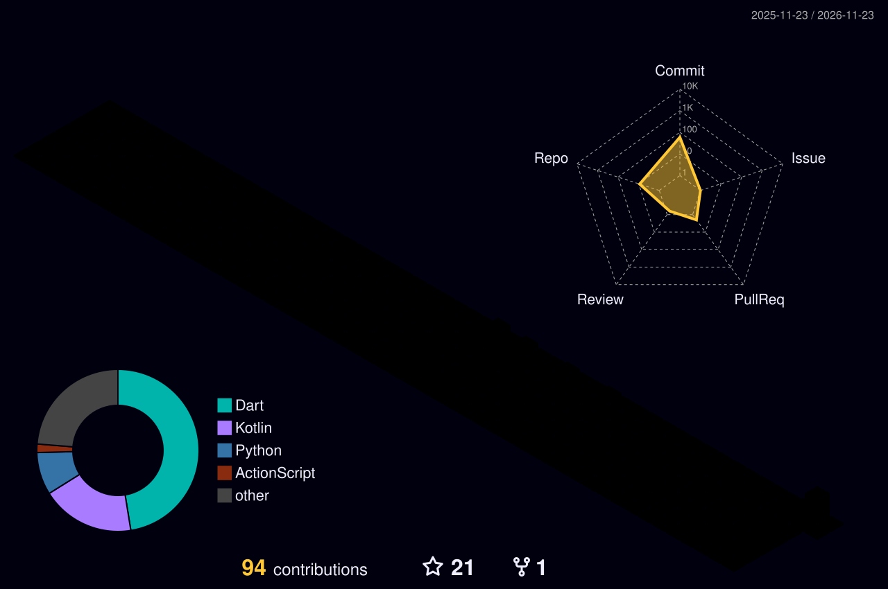
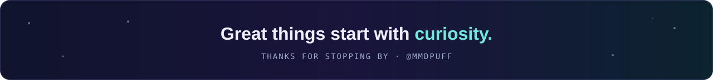

<!-- ━━━━━━━━━━━━━━━  MMDPUFF  /  PROFILE  ━━━━━━━━━━━━━━━ -->
<!-- This README belongs in the public repository github.com/mmdpuff/mmdpuff -->

  

  

   
  
  
  

 

<!-- INTRO -->
<h2 align="left">✦ &nbsp; <samp>01 / THE PERSON BEHIND THE CODE</samp></h2>

<table>
  <tr>
    <td width="53%" valign="middle">
      <h3>Hey, I'm Mohammad 👋</h3>
      
I'm a software engineer from Iran who enjoys turning ideas into real, useful things — from polished mobile interfaces to tiny boards that talk to your phone.

      
My world lives at the intersection of <b>mobile development</b> and <b>connected hardware</b>. I build with <b>Flutter &amp; Dart</b>, develop native Android experiences using <b>Kotlin</b>, and experiment with <b>ESP32 &amp; MicroPython</b>.

      
Currently fascinated by <b>Jetpack Compose, Bluetooth Low Energy (BLE)</b>, and making software interact with the physical world.

      
⚡ <i>Curious by default. Building one idea at a time.</i>

    </td>
    <td width="47%" valign="middle">
      
    </td>
  </tr>
</table>

<!-- FOCUS -->
<h2>⚡ &nbsp; <samp>02 / CURRENTLY IN MY LAB</samp></h2>

<table>
  <tr>
    <td width="33%" align="center" valign="top">
      <h3>📱 Native Android</h3>
      
<b>Kotlin · Jetpack Compose</b>

      
Building clean Android interfaces and exploring modern app architecture.

    </td>
    <td width="34%" align="center" valign="top">
      <h3>🦋 Cross-platform</h3>
      
<b>Flutter · Dart</b>

      
Crafting smooth, responsive app experiences across devices.

    </td>
    <td width="33%" align="center" valign="top">
      <h3>📡 Connected Devices</h3>
      
<b>ESP32 · MicroPython · BLE</b>

      
Connecting apps and microcontrollers to bring hardware ideas to life.

    </td>
  </tr>
</table>

<!-- TECH -->
<h2>🧬 &nbsp; <samp>03 / MY TECH UNIVERSE</samp></h2>

  
<b>Mobile &amp; embedded</b>

  
  
   

   
  
<b>Web &amp; development tools</b>

  

<!-- PROJECTS -->
<h2>🚀 &nbsp; <samp>04 / WORK OUT IN THE WILD</samp></h2>

<table>
  <tr>
    <td width="50%" valign="top">
      <h3>💡 <a href="https://github.com/mmdpuff/LUMIO">LUMIO</a></h3>
      
<b>Kotlin · Jetpack Compose · BLE · ESP32</b>

      
A native Android companion that connects to an ESP32 through Bluetooth Low Energy and controls its onboard LED. A little light, a lot of atmosphere.

      
    </td>
    <td width="50%" valign="top">
      <h3>✅ <a href="https://github.com/mmdpuff/todolist_app">todolist_app</a></h3>
      
<b>Flutter · Dart</b>

      
A Flutter-based to-do application project — a place to explore mobile UI, everyday workflows, and app development.

      
    </td>
  </tr>
</table>

<a href="https://github.com/mmdpuff?tab=repositories"><b>↳ Explore all public repositories</b></a>

<!-- ACTIVITY -->
<h2>📈 &nbsp; <samp>05 / THE COMMIT FREQUENCY</samp></h2>

  

  
<b>📊 More GitHub activity stats</b>

   
  

    
  

  These widgets use public GitHub data and are served by third-party services; they can occasionally be unavailable.

<!-- 3D CONTRIBUTION CITY, generated by .github/workflows/profile-3d.yml -->
<h2>🌌 &nbsp; <samp>06 / MY CONTRIBUTIONS IN 3D</samp></h2>

  <picture>
    <source media="(prefers-color-scheme: dark)" srcset="./profile-3d-contrib/profile-night-rainbow.svg" />
    <source media="(prefers-color-scheme: light)" srcset="./profile-3d-contrib/profile-season-animate.svg" />
    
  </picture>
  A little city built from real commits. Generated by GitHub Actions after its first run.

<!-- SNAKE, generated by .github/workflows/snake.yml -->
<h2>🐍 &nbsp; <samp>07 / LET THE CONTRIBUTIONS FLOW</samp></h2>

  <picture>
    <source media="(prefers-color-scheme: dark)" srcset="https://raw.githubusercontent.com/mmdpuff/mmdpuff/output/github-snake-dark.svg" />
    <source media="(prefers-color-scheme: light)" srcset="https://raw.githubusercontent.com/mmdpuff/mmdpuff/output/github-snake.svg" />
    
  </picture>
  Generated automatically using GitHub Actions. Run the workflow once after uploading these files.

 

  
  
<samp>Made with curiosity, coffee, and a few too many open editor tabs.</samp>

